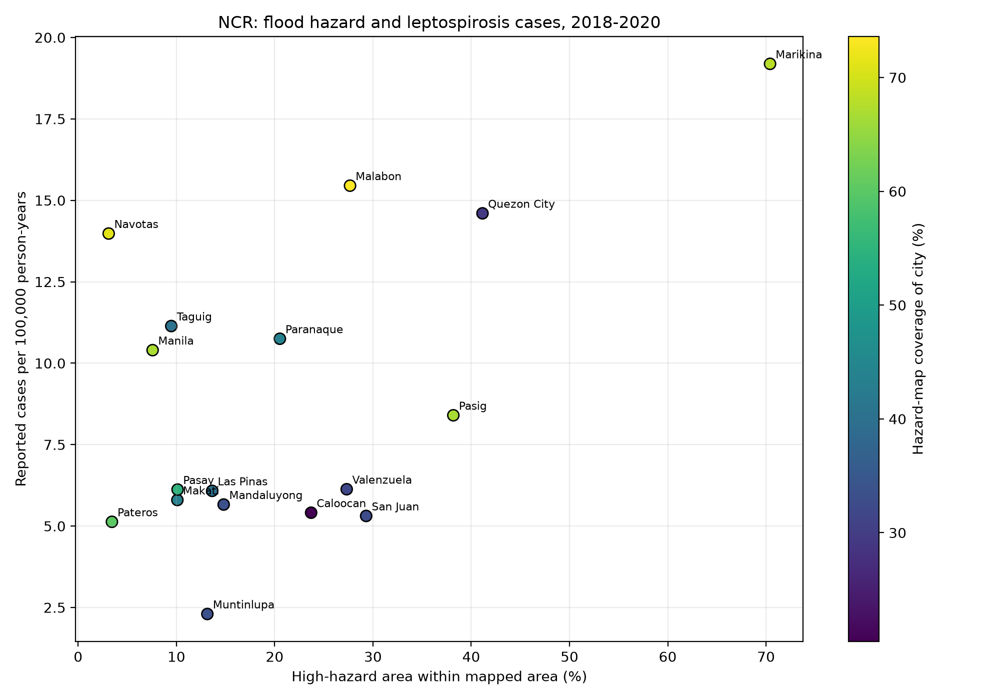

# Infrastructure and Leptospirosis in the Philippines

Philippines infrastructure and leptospirosis
It examines whether there is a relationship between the improvement of infrastructure and the number of reported cases of leptospirosis
It organizes the open statistical data and numbers and compares them using charts
## Data

The analysis will use publicly available data on sanitation infrastructure and reported leptospirosis cases in the Philippines.
## Research question

Are reported leptospirosis cases associated with access to sanitation services in the Philippines?
## Planned data sources

- World Bank: people using at safely managed sanitation services (% of population)
- Philippines Department of Health: reported leptospirosis cases
 ## Sanitation data

The sanitation indicator is "People using safely managed sanitation services (% of population)" from the World Bank.

| Year | People using safely managed sanitation services (%) |
|---|---:|
| 2020 | 59.8579 |
| 2021 | 60.4412 |
| 2022 | 61.0222 |
| 2023 | 61.6002 |
| 2024 | 62.1744 | 
## Source

World Bank Data:
https://data.worldbank.org/indicator/SH.STA.SMSS.ZS?locations=PH
## Background

Leptospirosis outbreaks in the Philippines have been associated with flooding, heavy rainfall, poor sanitation, and inadequate waste management.

A 2024 review reported 182 cases in 2020, 1,661 cases in 2021, and 2,794 cases in 2022.

## Background source

- Unraveling the leptospirosis epidemic: tales from the Philippine outbreak – a short communication
  https://pmc.ncbi.nlm.nih.gov/articles/PMC10849348/
  ## Leptospirosis cases

| Year | Reported cases |
|---|---:|
| 2020 | 182 |
| 2021 | 1661 |
| 2022 | 2794 |
## First observation

From 2020 to 2022, reported leptospirosis cases increased sharply, while access to safely managed sanitation services increased slightly.
## Limitation

This simple comparison does not show that sanitation conditions caused the change in leptospirosis cases. Other factors, such as flooding, rainfall, reporting practices, and public health measures, may also have influenced the number of reported cases.

## Preliminary NCR Analysis (2018–2020)

### Research question

Across the 17 cities and municipality in the National Capital Region (NCR), do places with a larger share of mapped high flood hazard area also have higher reported leptospirosis case rates?

### Data and method

- **Cases:** City-level reports from the Philippine Department of Health (DOH) Metro Manila Center for Health Development / NCR city-level source PDF for 2016–2020. Annual city totals were checked against the PDF's Grand Totals. Pateros is omitted in 2016–2017, so the comparison uses 2018–2020 to include all 17 local government units with case observations.
- **Population:** PSA 2020 Census of Population and Housing NCR press release (Reference No. 2021-314, Table 3), which reports city/municipality counts for 2015 and 2020. Population for 2018–2020 was estimated by linear interpolation between those census counts. Rates are reported cases per 100,000 person-years.
- **Flood hazard:** NOAH's 100-year Metro Manila flood hazard scenario. The polygon attributes Var 1/2/3 were interpreted as low/medium/high; high hazard means depth greater than 1.5 m, based on the prior metadata review. This is a static scenario, not flooding observed during 2018–2020.
- **Boundaries:** ArcGIS NCR_Boundaries FeatureServer, layer 0. The queried features were checked to include all 17 features with REGION=NCR, including Manila City.

### Preliminary observation

The scatter plot appeared to slope upward between the high-hazard share within mapped areas and reported cases per 100,000 person-years. This is a visual observation only; no statistical correlation has been calculated, and it is not evidence of a proven association or cause.

### Limitations and next steps

The high-hazard percentage uses only the area covered by hazard polygons as its denominator, not the whole city. Polygon coverage varies markedly by city (roughly 20–74%); across all NCR boundaries, polygons cover 245.71 of 601.73 sq km (40.83%). The available ZIP/README does not document whether an area with no hazard polygon means no hazard, so that interpretation remains unresolved. The comparison is ecological (city-level) and exploratory: unequal map coverage, interpolated populations, unmeasured factors, only 17 local government units, and reported cases that may not represent all infections limit interpretation. Next steps are to resolve the no-polygon interpretation, quantify the relationship statistically, and test how the results change under alternative coverage assumptions. The analysis is not complete.

### City comparison results (2018–2020)

The table compares reported leptospirosis cases per 100,000 person-years with the share of high-hazard area within the parts of each city covered by the NOAH hazard polygons. Population figures for 2018–2020 were estimated from the 2015 and 2020 census counts.

| City/Municipality | Reported cases (2018–2020) | Cases per 100,000 person-years | Hazard-map coverage of city (%) | High hazard within mapped area (%) |
|---|---:|---:|---:|---:|
| Manila | 572 | 10.40 | 66.87 | 7.58 |
| Mandaluyong | 71 | 5.66 | 33.51 | 14.81 |
| Marikina | 262 | 19.19 | 67.88 | 70.41 |
| Pasig | 200 | 8.40 | 66.56 | 38.18 |
| Quezon City | 1,294 | 14.60 | 29.26 | 41.15 |
| San Juan | 20 | 5.31 | 32.64 | 29.31 |
| Caloocan | 267 | 5.41 | 20.44 | 23.71 |
| Malabon | 175 | 15.45 | 73.62 | 27.67 |
| Navotas | 104 | 13.98 | 71.14 | 3.11 |
| Valenzuela | 128 | 6.13 | 31.84 | 27.33 |
| Las Piñas | 110 | 6.08 | 40.02 | 13.64 |
| Makati | 108 | 5.80 | 43.35 | 10.10 |
| Muntinlupa | 37 | 2.30 | 33.42 | 13.15 |
| Parañaque | 221 | 10.75 | 43.77 | 20.53 |
| Pasay | 80 | 6.12 | 54.59 | 10.12 |
| Taguig | 291 | 11.14 | 40.79 | 9.48 |
| Pateros | 10 | 5.13 | 60.24 | 3.44 |

The scatter plot appears to slope upward when comparing high-hazard share with reported case rates. This is a visual observation only; no statistical correlation has been calculated. The high-hazard share is calculated only within the mapped area, and map coverage differs substantially among cities.

